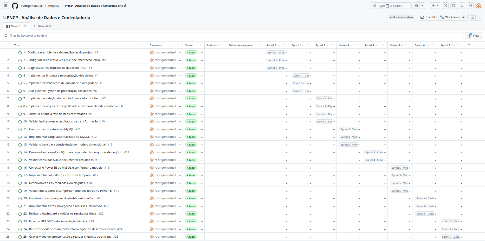
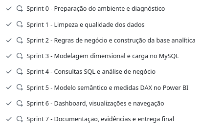
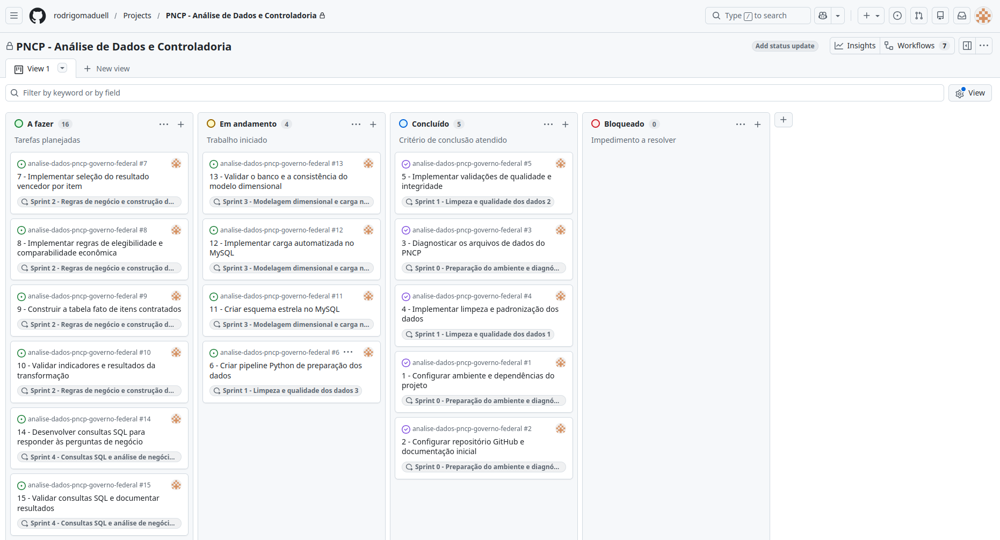
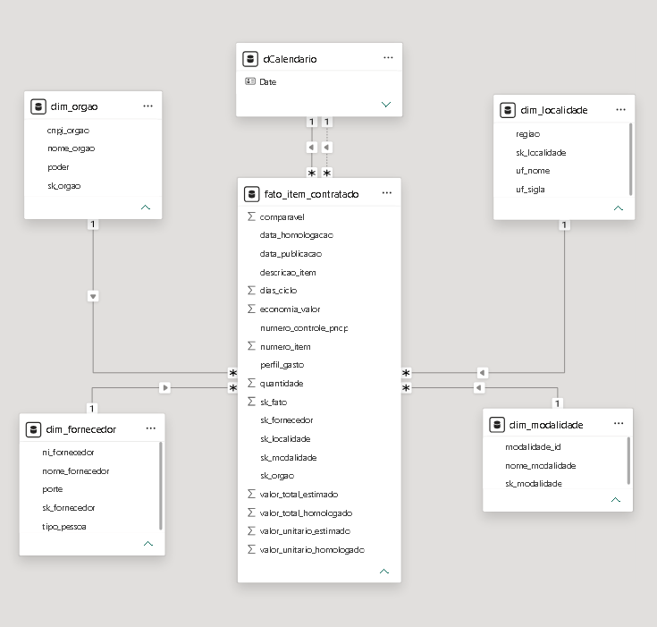
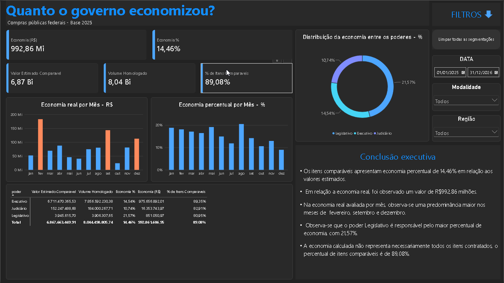
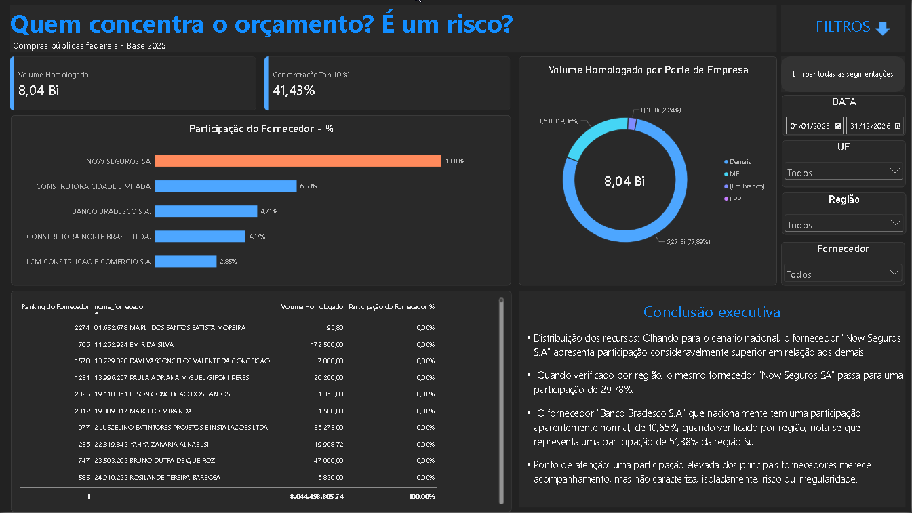
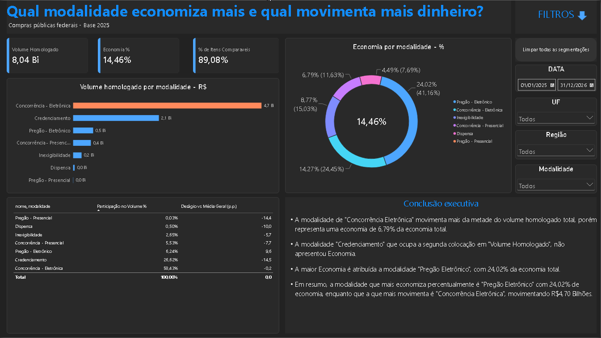
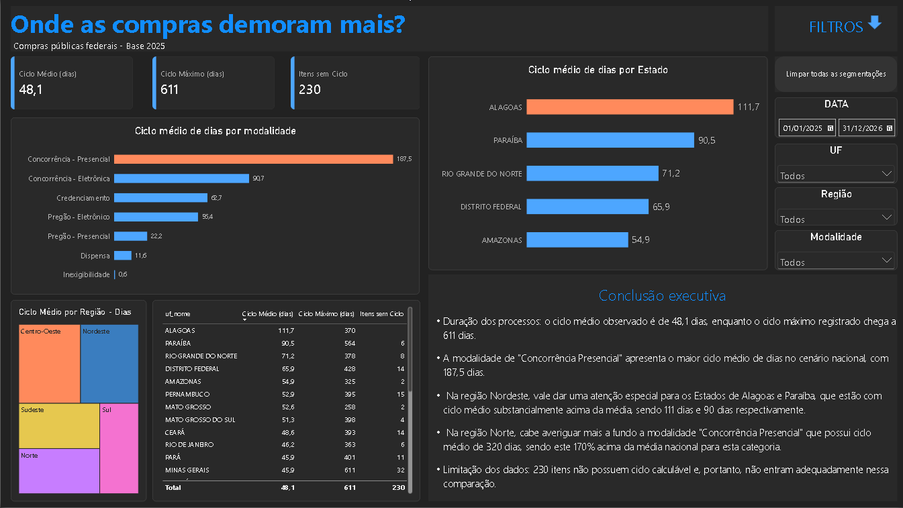
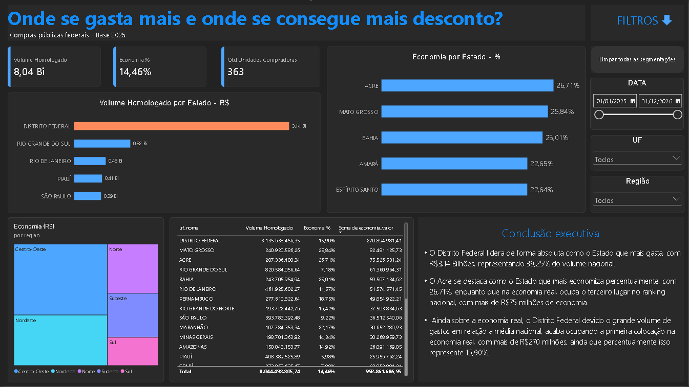
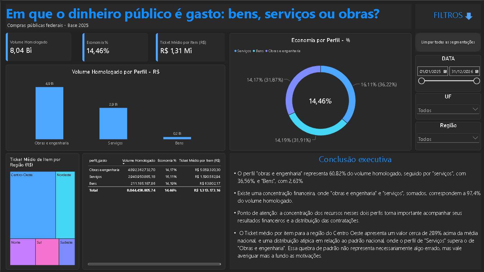

| Nome                    | Instituição | Curso             | Turma |
| ----------------------- | ------------- | ----------------- | :---: |
| Rodrigo Maduell Fonseca | SCTEC / SENAI | Análise de Dados |  T2  |


# Análise de Contratações Públicas do Governo Federal

Projeto de análise de dados do Portal Nacional de Contratações Públicas (PNCP), desenvolvido com Python, MySQL, SQL e Power BI, com foco na análise de gastos públicos, economia nas contratações, concentração de fornecedores e prazos dos processos.

## Objetivo

Transformar dados de contratações públicas em informações que apoiem a análise e o acompanhamento dos gastos governamentais, identificando padrões, diferenças regionais e situações que mereçam investigação pela Controladoria.

## Tecnologias utilizadas

- **Python e Pandas:** preparação, limpeza, transformação e auditoria dos dados.
- **MySQL e SQL:** armazenamento estruturado, modelagem dimensional e consultas analíticas.
- **Power BI e DAX:** modelagem analítica, indicadores e visualizações interativas.
- **Git e GitHub:** versionamento e documentação do projeto.

## Etapas desenvolvidas

1. Diagnóstico e preparação dos dados.
2. Limpeza, padronização e aplicação das regras de negócio.
3. Auditoria dos itens rejeitados.
4. Modelagem dimensional e carga no MySQL.
5. Desenvolvimento de consultas SQL para análise dos resultados.
6. Construção do modelo analítico e das medidas DAX no Power BI.
7. Desenvolvimento de dashboard com seis páginas temáticas.
8. Elaboração de conclusões executivas e documentação dos resultados.

## Auditoria e validação dos dados

A preparação dos dados é realizada com Python e Pandas. Os itens são avaliados conforme os critérios de validade definidos no enunciado. Quando um item se enquadra em mais de um critério, é contabilizado somente pelo primeiro motivo aplicável, respeitando a ordem das regras.

### Resultado da auditoria

Na execução documentada do script de montagem das tabelas, foram identificados:

- **6.225 itens** com resultado antes da aplicação das regras de rejeição.
- **99 itens rejeitados**, que não entram na tabela fato.
- **6.126 itens** mantidos na tabela fato.

### Motivos das rejeições

| Motivo                                                          |   Quantidade |
| --------------------------------------------------------------- | -----------: |
| Valor total estimado menor que R$ 1                             |           59 |
| Valor unitário estimado inválido (ausente ou não positivo)   |           23 |
| Valor homologado superior a 1.000 vezes o estimado              |            7 |
| Valor unitário homologado inválido (ausente ou não positivo) |            6 |
| Valor total estimado ou homologado acima de R$ 1 trilhão       |            3 |
| Quantidade inválida (ausente ou não positiva)                 |            1 |
| **Total**                                                 | **99** |

Os itens sem resultado homologado são tratados separadamente e não são contabilizados como rejeições nessa etapa.

### Indicadores conferidos

Os resultados da execução foram comparados com os números de referência do Anexo 8 do enunciado.

| Indicador                         |           Resultado |
| --------------------------------- | ------------------: |
| Itens na tabela fato              |               6.126 |
| Contratações distintas          |               1.962 |
| Fornecedores distintos            |               2.652 |
| Órgãos distintos (CNPJ)         |                 363 |
| Volume homologado                 | R$ 8.044.498.805,74 |
| Itens comparáveis                |               5.457 |
| Economia sobre itens comparáveis |              14,46% |
| Ciclo médio de contratação     |           48,1 dias |
| Ciclo máximo de contratação    |            611 dias |
| Itens sem ciclo calculável       |                 230 |

A distribuição do volume homologado por perfil também corresponde aos valores de referência: Obras e Engenharia (60,8%), Serviços (36,6%) e Bens (2,6%).

## Modelagem e análise SQL

Os dados foram organizados em uma estrutura dimensional no MySQL, com uma tabela fato de itens contratados e dimensões relacionadas a órgãos, fornecedores, localidades e modalidades de contratação.

As consultas analíticas foram organizadas em scripts SQL .

## Dashboard Power BI

O dashboard foi desenvolvido para explorar os resultados por diferentes perspectivas, utilizando medidas DAX, filtros e visualizações interativas.

### Páginas do dashboard

1. **Economia nas contratações:** comparação entre valores estimados e homologados, economia observada e cobertura dos itens comparáveis.
2. **Concentração de fornecedores:** distribuição dos recursos entre fornecedores e análise da participação dos principais participantes.
3. **Modalidades de contratação:** comparação entre volume homologado e economia por modalidade.
4. **Ciclo das contratações:** análise dos prazos médios e máximos, com recortes por modalidade e unidade federativa.
5. **Análise regional:** distribuição dos gastos e da economia entre as unidades federativas.
6. **Perfil dos gastos:** distribuição do volume homologado entre Bens, Serviços e Obras e Engenharia, incluindo a análise do ticket médio por item.

As conclusões executivas de cada página destacam resultados observados nos indicadores e apontam situações que podem merecer investigação complementar. Os resultados devem ser interpretados considerando os filtros aplicados e as limitações de cada indicador.

### Evidências visuais

As capturas do modelo dimensional e das páginas do dashboard podem ser consultadas na pasta `docs/img/`.

* **Metodologias Ágeis - Planejamento em Sprints:**

  

Na imagem acima as Sprints estão cortadas devido o estreitamento das colunas, abaixo está a imagem constando as 7 Sprints:



- Demonstração da evolução do projeto fazendo o uso de Kanban para organização e acompanhamento:




* **Modelo Dimensional Star Schema no Power BI**




* **Paineis Construídos para resposta das 6 perguntas de negócio no Power BI**

- P1 - Painel Economia:



- P2 - Painel Fornecedores:



- P3 - Painel Modalidades:



- P4 - Painel Ciclo:



- P5 - Painel Regional:



- P6 - Painel Perfil:




## Estrutura do Projeto

```text
.
├── data/
│   ├── raw/
│   └── processed/
├── src/
├── sql/
├── docs/
│   ├── analise_resultados_sql.md
│   └── img/
├── powerbi/
│   └── Dashboards.pbix
└── README.md
```


## Execução da preparação dos dados

Com Python e as dependências do projeto instaladas, execute a partir da raiz do repositório:

```bash
python -m src.montar_tabelas
```

O script realiza a montagem das tabelas processadas e apresenta os totais da auditoria e os indicadores utilizados na conferência com o Anexo 8 do enunciado.

A execução das consultas SQL e a atualização do dashboard dependem da configuração do banco de dados e da conexão utilizada no ambiente local.

## Resultados e limitações

A análise identificou economia de 14,46% nos itens comparáveis e diferenças na distribuição dos recursos entre fornecedores, modalidades, regiões e perfis de contratação.

Os indicadores de economia são limitados aos itens contemplados pelas regras de comparabilidade. Da mesma forma, os ciclos de contratação dependem da disponibilidade e da validade das datas utilizadas no cálculo.

As concentrações financeiras e os prazos elevados apontam situações que podem justificar análises complementares, mas não comprovam, isoladamente, irregularidades ou suas causas.

## Status

Projeto desenvolvido com preparação e auditoria dos dados em Python, armazenamento e análise em MySQL/SQL e visualização analítica em Power BI.

Consulte os scripts, a documentação SQL e o arquivo do dashboard para conhecer os detalhes da implementação.
